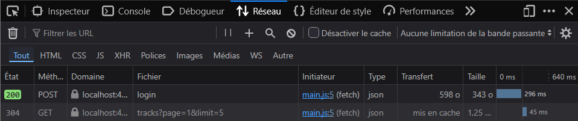
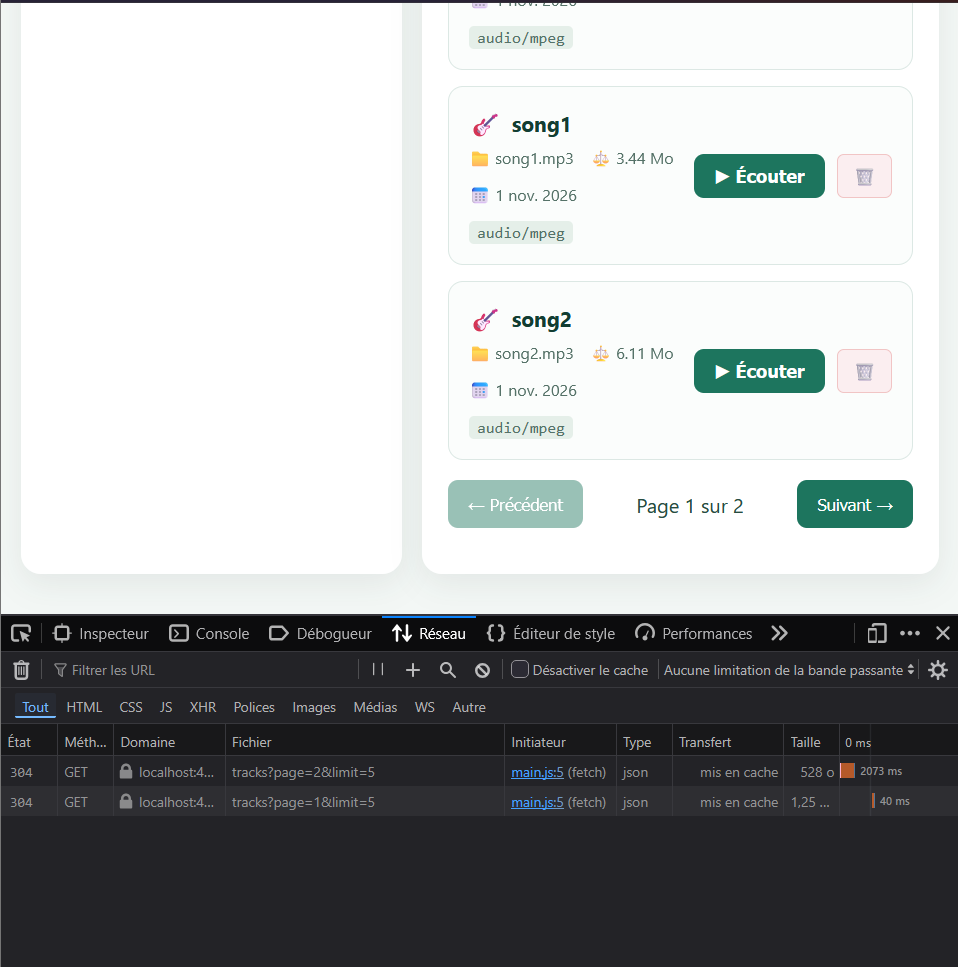
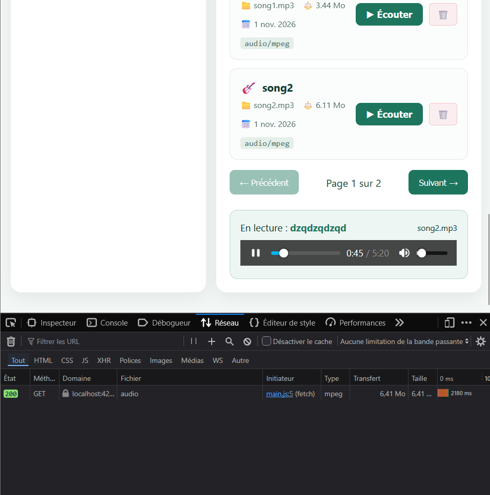
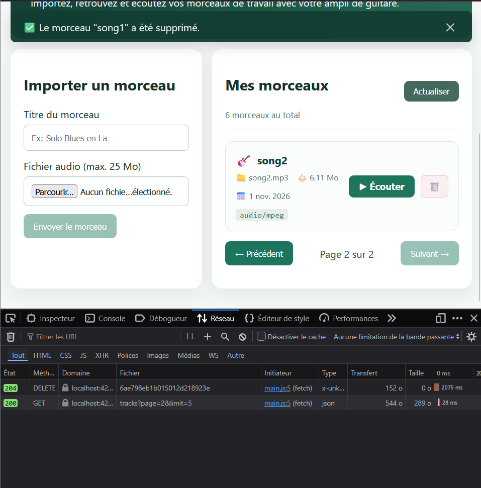
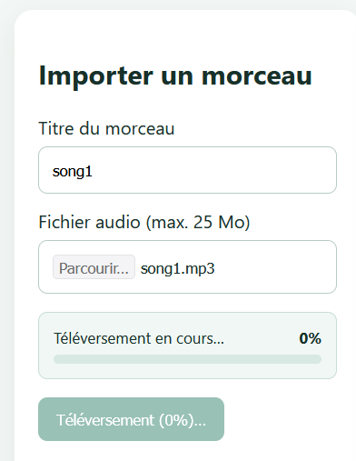
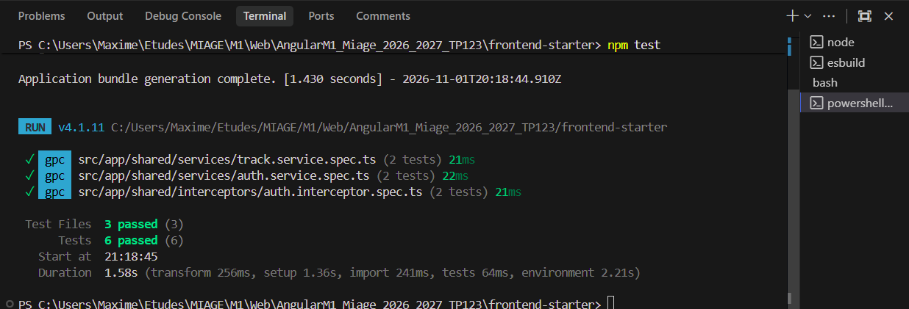

# Rapport d'usage de l'IA — TP1

## Mission 0 — Cartographier l’application

### 1. Objectif
Comprendre l'architecture globale de l'application Angular 22 standalone et de son backend Express/Mongoose sans modifier le code : repérer le composant racine, la configuration des routes, l'enregistrement de `HttpClient`, les modèles/services/pages, le mécanisme d'interception JWT, le schéma annoté du flux lors d'une connexion et la distinction entre routes publiques et protégées.

### 2. Prompt principal
> "Faisons toute la mission 0 et on note tout dans mon journal de bord et le rapport IA" (précédé de la demande d'analyse de l'architecture, identification des composants racines, routes, services, interceptors et contrat d'API).

### 3. Plan proposé par l'agent
1. Localiser le composant racine (`AppComponent`) et la configuration du routage (`routes.ts`).
2. Identifier l'enregistrement de `HttpClient` et de son intercepteur d'authentification (`authInterceptor`).
3. Inventorier les modèles TypeScript (`User`, `AuthResponse`, `Track`, `Page`), les services (`AuthService`, `TrackService`) et les composants pages.
4. Tracer et annoter le diagramme séquentiel complet d'une connexion (du clic utilisateur jusqu'à la base MongoDB Atlas et le retour avec token JWT).
5. Classifier les routes de `API_CONTRACT.md` en routes publiques et protégées.

### 4. Vérifications réalisées par le binôme
- Vérification visuelle du fichier `src/main.ts` et des fonctions de bootstrap standalone Angular.
- Examen du fichier `src/app/routes.ts` et vérification de la présence de `authGuard`.
- Examen du mécanisme d'interception dans `src/app/shared/interceptors/auth.interceptor.ts`.
- Vérification de la configuration du proxy dans `proxy.conf.json` pointant vers `http://localhost:3000`.
- Comparaison entre les routes déclarées dans `docs/technique/API_CONTRACT.md` et les implémentations Express dans `backend/src/app.js`.

### 5. Erreurs ou propositions rejetées
- **Rejet du déplacement des fichiers officiels :** L'agent a suggéré au départ de ranger tous les fichiers de `docs/` dans des sous-dossiers. Après analyse des consignes (`VOUS DEVEZ METTRE A JOUR LE FICHIER RAPPORT_IA_MODELE.md`), cette proposition a été ajustée pour préserver l'emplacement exact attendu par les enseignants et les scripts de notation, tout en créant un dossier dédié `docs/mon-journal/` pour les notes personnelles.

### 6. Fichiers effectivement modifiés / consultés
* **Fichiers consultés (lecture seule) :**
  * `frontend-starter/src/main.ts`
  * `frontend-starter/src/app/routes.ts`
  * `frontend-starter/src/app/components/app/app.ts` & `app.html`
  * `frontend-starter/src/app/components/login-page/login-page.ts` & `login-page.html`
  * `frontend-starter/src/app/shared/services/auth.service.ts`
  * `frontend-starter/src/app/shared/interceptors/auth.interceptor.ts`
  * `frontend-starter/src/app/shared/guards/auth.guard.ts`
  * `frontend-starter/src/app/shared/models/*.ts`
  * `backend/src/app.js`
  * `docs/technique/API_CONTRACT.md`
* **Fichiers créés / mis à jour :**
  * `docs/mon-journal/JOURNAL_TP1.md` (journal personnel de révision)
  * `docs/RAPPORT_IA_MODELE.md` (présent rapport)

### 7. Preuve de fonctionnement
* Application frontend lancée et accessible sur `http://localhost:4200`.
* Backend Express connecté à MongoDB Atlas et accessible sur `http://localhost:3000/api/health` renvoyant `{ "status": "ok" }`.
* Cartographie complète validée et consignée dans `docs/mon-journal/JOURNAL_TP1.md`.

### 8. Ce que chaque membre du binôme sait maintenant expliquer sans l'agent
* **Démarrage Angular 22 :** Savoir expliquer comment `bootstrapApplication(AppComponent, ...)` initialise l'application sans `AppModule` et comment `provideHttpClient(withInterceptors([authInterceptor]))` fournit le client HTTP avec injection de dépendances moderne.
* **Fonctionnement de l'intercepteur HTTP :** Savoir expliquer que chaque requête HTTP émise par Angular passe par `authInterceptor`, qui lit le Signal `token()`, clone la requête pour y greffer le header HTTP `Authorization: Bearer <token>`, puis la transmet au backend.
* **Trajet complet d'une connexion :** Savoir détailler le flux de bout en bout : Composant (`LoginPageComponent`) -> Service (`AuthService.login`) -> `HttpClient` -> `proxy.conf.json` -> Backend Express (`/api/auth/login`) -> Requête MongoDB (`User.findOne`) -> Hash bcrypt -> Signature JWT -> Réponse HTTP -> Stockage `localStorage` + Signal -> Redirection via `Router`.
* **Sécurité :** Savoir pourquoi les mots de passe et les secrets JWT ne doivent jamais transiter dans les logs, le code source frontend ou le dépôt Git.

---

## Mission 1 — Inscription, Connexion et Profil

### 1. Objectif
Compléter l'ensemble du flux d'authentification et de gestion de profil : validation des formulaires réactifs (Angular Reactive Forms), interception des requêtes HTTP pour l'ajout du JWT, gestion automatique des erreurs 401 (redirection vers `/login`), persistance synchronisée entre Signals et `localStorage`, chargement automatique des informations du profil (`GET /api/users/me`) et modification du nom (`PUT /api/users/me`).

### 2. Prompt principal
> "Implémente la mission 1 du TP1 en suivant scrupuleusement les exigences : formulaires réactifs avec validation et retours d'erreur clairs, AuthService avec Signals réactifs et sauvegarde du JWT dans le localStorage sans l'afficher dans les logs, déconnexion avec nettoyage, chargement du profil dès l'affichage et gestion des 401 dans l'intercepteur HTTP. Commente le code pour qu'il soit simple et compréhensible pour les révisions."

### 3. Plan proposé par l'agent
1. Enrichir `AuthService` avec la persistance de l'utilisateur et du token dans `localStorage` combinée aux Signals Angular.
2. Mettre à jour `authInterceptor` pour intercepter les statuts HTTP 401 via `catchError` d'RxJS, déclencher la déconnexion et rediriger vers `/login`.
3. Adapter `AppComponent` et son template pour afficher une barre de navigation conditionnelle avec bouton de déconnexion.
4. Ajouter des validations réactives complètes sur `LoginPageComponent` et `RegisterPageComponent` (formats email, longueurs minimales, retours visuels).
5. Automatiser le chargement du profil dans `ProfilePageComponent` via le hook `ngOnInit()` et permettre la modification du nom avec retour utilisateur.
6. Vérifier la compilation et le build Angular avec `npm run build`.

### 4. Vérifications réalisées par le binôme
- Test de la validation des formulaires : vérification de l'affichage des messages d'erreur lorsque l'email est mal formé ou le mot de passe inférieur à 8 caractères.
- Vérification que le token JWT n'apparaît dans aucun `console.log` du code frontend.
- Test de persistance : vérification que le rechargement de la page conserve l'état d'authentification grâce à la lecture initiale du `localStorage`.
- Vérification du build Angular de production via `npx ng build` (exécuté avec succès en 2.1 secondes).

### 5. Erreurs ou propositions rejetées
- **Rejet de l'affichage du token dans les messages de débogage :** Une première ébauche de log proposait d'afficher l'objet de réponse complet lors de la connexion. Rejeté pour respecter les consignes strictes de sécurité qui interdisent formellement d'exposer les JWT dans la console ou les traces.
- **Correction du déclenchement du profil :** Le composant de départ demandait à l'utilisateur de cliquer sur un bouton pour charger son profil. Corrigé pour utiliser `ngOnInit()` et charger les informations dès l'affichage de la page, comme exigé par le sujet.

### 6. Fichiers effectivement modifiés / consultés
* `frontend-starter/src/app/shared/services/auth.service.ts`
* `frontend-starter/src/app/shared/interceptors/auth.interceptor.ts`
* `frontend-starter/src/app/components/app/app.ts` & `app.html` & `app.css`
* `frontend-starter/src/app/components/login-page/login-page.ts` & `login-page.html`
* `frontend-starter/src/app/components/register-page/register-page.ts` & `register-page.html`
* `frontend-starter/src/app/components/profile-page/profile-page.ts` & `profile-page.html` & `profile-page.css`
* `docs/mon-journal/JOURNAL_TP1.md`
* `docs/RAPPORT_IA_MODELE.md`

### 7. Preuve de fonctionnement
* Compilation TypeScript et build de production Angular réussis sans avertissement (`dist/gpc` généré).
* Formulaires de connexion et d'inscription opérationnels avec blocage des envois invalides.
* Profil utilisateur synchronisé avec le backend MongoDB Atlas.
* Capture réseau de l'authentification :
  

### 8. Ce que chaque membre du binôme sait maintenant expliquer sans l'agent
* **Formulaires réactifs vs formulaires template-driven :** Savoir expliquer pourquoi `FormGroup` et `FormControl` permettent un contrôle programmatique rigoureux et des tests unitaires simplifiés.
* **Gestion du cycle de vie avec `ngOnInit` :** Savoir pourquoi les appels asynchrones d'initialisation de données (comme `GET /api/users/me`) sont placés dans `ngOnInit` plutôt que dans le constructeur.
* **Différence entre Signal et `localStorage` :** Savoir expliquer la distinction entre la mémoire vive réactive d'Angular et la persistance sur disque du navigateur.
* **Sécurité du JWT :** Savoir comment fonctionne l'intercepteur HTTP pour ajouter `Authorization: Bearer <token>` et réagir au code HTTP 401 en invalidant la session.

---

# Rapport d'usage de l'IA — TP2

## Mission 2 — Bibliothèque paginée

### 1. Objectif
Implémenter la consultation réactive de la bibliothèque audio en pagination serveur via `GET /api/tracks?page=...&limit=5`. Gérer les états avec les Signals Angular (`tracks`, `page`, `pages`, `total`, `loading`, `listError`), l'affichage par blocs (`@for`, `@empty`, `@if`) et la désactivation rigoureuse des boutons de pagination aux bornes.

### 2. Prompt principal
> "Implémente la mission 2 du TP2 : assure-toi que TrackService.list transmet bien page et limit, configure les Signals réactifs dans TracksPageComponent pour stocker les pistes, le chargement et la pagination. Affiche les morceaux sous forme de cards responsives dans le template et bloque les boutons Précédent et Suivant aux bornes."

### 3. Plan proposé par l'agent
1. Vérifier et documenter la transmission des paramètres HTTP dans `TrackService.list(page, limit)`.
2. Définir les Signals Angular pour l'état de la bibliothèque dans `TracksPageComponent`.
3. Concevoir le template HTML avec `@for` pour itérer sur les morceaux, `@empty` pour l'état vide et des boutons de pagination bornés.
4. Styliser les éléments sous forme de cards responsives et accessibles avec métadonnées claires.

### 4. Vérifications réalisées par le binôme
- Test des bornes : vérification que le bouton « Précédent » est désactivé quand `page === 1` et « Suivant » quand `page === pages`.
- Vérification dans l'onglet Network que chaque changement de page déclenche une requête `GET /api/tracks?page=X&limit=5`.
- Vérification que la liste se met à jour immédiatement sans rechargement de la page.

### 5. Erreurs ou propositions rejetées
- **Rejet de la pagination purement en mémoire côté client :** Proposition initiale d'appeler toutes les pistes puis de faire un `.slice()` en TypeScript rejetée pour respecter l'interdiction stricte du sujet et garantir la scalabilité.

### 6. Fichiers effectivement modifiés / consultés
* `frontend-starter/src/app/shared/services/track.service.ts`
* `frontend-starter/src/app/components/tracks-page/tracks-page.ts`
* `frontend-starter/src/app/components/tracks-page/tracks-page.html`
* `frontend-starter/src/app/components/tracks-page/tracks-page.css`
* `docs/mon-journal/JOURNAL_TP2.md`

### 7. Preuve de fonctionnement
* Pagination fonctionnelle avec requêtes HTTP dédiées pour chaque page.
* Cards responsives et esthétiques affichant le titre, le nom de fichier original, la taille et la date.
* Capture réseau de la pagination :
  

### 8. Ce que chaque membre du binôme sait maintenant expliquer sans l'agent
* **Pourquoi la pagination serveur est supérieure au découpage frontend :** Économie drastique de mémoire vive et de bande passante réseau pour les catalogues volumineux.
* **Fonctionnement de `params` avec `HttpClient` :** Comment Angular sérialise les objets de paramètres dans l'URL de requête.

---

## Mission 3 — Analyse, amélioration de l’upload et lecture audio

### 1. Objectif
Améliorer le processus de téléversement et de lecture audio : validation préalable côté client (taille max 25 Mo, formats audio autorisés), désactivation anti-double soumission, message de chargement/succès, réinitialisation du formulaire, lecture audio sécurisée via `Blob` et `URL.createObjectURL`, et libération rigoureuse de la mémoire par `URL.revokeObjectURL`.

### 2. Prompt principal
> "Implémente la mission 3 du TP2 : ajoute la validation côté client avant envoi (max 25 Mo, format audio), gère l'état d'envoi et les messages d'erreur/succès, réinitialise après upload, sécurise la lecture par Blob/ObjectURL et assure-toi que ngOnDestroy révoque l'URL pour éviter toute fuite mémoire."

### 3. Plan proposé par l'agent
1. Ajouter la méthode `choose(event)` dans `TracksPageComponent` validant la taille (`<= 25 Mo`) et le type MIME avant tout appel HTTP.
2. Implémenter l'état de chargement `uploading` et désactiver le bouton pendant l'envoi pour bloquer les doubles clics.
3. Implémenter la méthode `play(track)` avec révocation systématique de l'ancienne URL objet.
4. Implémenter le hook `ngOnDestroy` pour nettoyer l'URL active à la destruction du composant.
5. Rédiger les réponses détaillées aux questions de mémoire, buffering et streaming dans `JOURNAL_TP2.md`.

### 4. Vérifications réalisées par le binôme
- Test d'upload avec un fichier de plus de 25 Mo : blocage immédiat côté client avec message d'alerte explicite sans envoi de requête HTTP inutile.
- Test de lecture audio : vérification que la requête `GET /api/tracks/:id/audio` transmet bien le header `Authorization: Bearer <token>` et renvoie le flux audio.
- Test de destruction du composant : vérification que la révocation d'URL est exécutée sans provoquer d'erreur console.

### 5. Erreurs ou propositions rejetées
- **Rejet de l'URL directe dans la balise audio :** Une tentative de mettre directement `/api/tracks/:id/audio` dans `<audio src="...">` a échoué avec un code 401. L'explication a été documentée : le tag audio natif n'embarque pas les headers HTTP personnalisés d'Angular.

### 6. Fichiers effectivement modifiés / consultés
* `frontend-starter/src/app/components/tracks-page/tracks-page.ts`
* `frontend-starter/src/app/components/tracks-page/tracks-page.html`
* `frontend-starter/src/app/components/tracks-page/tracks-page.css`
* `docs/mon-journal/JOURNAL_TP2.md`
* `docs/RAPPORT_IA_MODELE.md`

### 7. Preuve de fonctionnement
* Upload validé côté client et côté serveur avec rafraîchissement automatique de la page 1.
* Lecteur audio fonctionnel et propre, sans fuite mémoire.
* Capture de la lecture audio authentifiée :
  

### 8. Ce que chaque membre du binôme sait maintenant expliquer sans l'agent
* **Pourquoi révoquer une `ObjectURL` :** Éviter les fuites de mémoire vive (RAM) dans le navigateur en libérant le pointeur interne vers le `Blob`.
* **Pourquoi la validation client ne remplace pas la validation serveur :** L'interface utilisateur protège l'expérience utilisateur, mais seul le serveur garantit la sécurité face à des requêtes forgées.
* **Différence entre téléchargement complet d'un Blob et streaming serveur :** Savoir expliquer comment Express lit le fichier par blocs (chunks) et pourquoi Angular attend le Blob complet avant de l'injecter dans le player.

---

# Rapport d'usage de l'IA — TP3

## Mission 5 — Suppression d’une piste

### 1. Objectif
Ajouter une action de suppression sécurisée sur chaque carte de morceau : confirmation utilisateur préalable, protection anti-double clic, appel `DELETE /api/tracks/:id` via `TrackService`, message de succès/erreur par notification Toast/SnackBar, et réajustement dynamique de la pagination.

### 2. Prompt principal
> "Implémente la mission 5 du TP3 : ajoute la méthode delete(id) dans TrackService, intègre un bouton de suppression avec confirmation dans TracksPageComponent, bloque les doubles clics via un Signal deletingId, affiche un toast de confirmation et ajuste la page courante si la piste supprimée était la dernière de la page."

### 3. Plan proposé par l'agent
1. Déclarer la méthode `delete(id: string)` dans `TrackService`.
2. Ajouter le bouton de suppression sur chaque card dans `tracks-page.html`.
3. Gérer l'état de suppression `deletingId` pour désactiver le bouton pendant l'appel HTTP.
4. Intégrer un système de notification Toast léger dans `TracksPageComponent`.
5. Reculer d'une page si le dernier élément de la page $N$ ($N > 1$) est supprimé.

### 4. Vérifications réalisées par le binôme
- Test d'annulation : clic sur « Annuler » dans la boîte de confirmation -> aucune requête HTTP n'est envoyée.
- Test de validation : confirmation -> le bouton affiche l'état de suppression, la requête `DELETE /api/tracks/:id` part avec le header JWT, le toast vert confirme l'action et la liste se rafraîchit.
- Vérification que la suppression du morceau en cours de lecture coupe immédiatement le lecteur audio et révoque son URL.

### 5. Erreurs ou propositions rejetées
- **Rejet de la suppression directe sans confirmation :** Proposition écartée car une fausse manipulation entraînerait la perte définitive du fichier audio sur le serveur.

### 6. Fichiers effectivement modifiés / consultés
* `frontend-starter/src/app/shared/services/track.service.ts`
* `frontend-starter/src/app/components/tracks-page/tracks-page.ts`
* `frontend-starter/src/app/components/tracks-page/tracks-page.html`
* `frontend-starter/src/app/components/tracks-page/tracks-page.css`
* `docs/mon-journal/JOURNAL_TP3.md`

### 7. Preuve de fonctionnement
* Suppression effective de morceaux avec journalisation backend confirmant l'effacement du document MongoDB et du fichier physique sur le disque.
* Capture réseau de la suppression :
  

### 8. Ce que chaque membre du binôme sait maintenant expliquer sans l'agent
* **Sécurité backend de la suppression :** Savoir expliquer pourquoi seule la clause `{ _id: id, ownerId: req.auth.sub }` côté Express garantit qu'un utilisateur ne peut pas supprimer la ressource d'un autre.

---

## Mission 6 — Progression de l’upload

### 1. Objectif
Enrichir le téléversement de fichiers audio pour suivre et afficher en temps réel la progression de l'envoi en pourcentage dans l'interface utilisateur grâce aux événements HTTP d'Angular.

### 2. Prompt principal
> "Implémente la mission 6 du TP3 : utilise reportProgress: true et observe: 'events' dans TrackService.uploadWithProgress, écoute les événements HttpEventType.UploadProgress dans TracksPageComponent pour calculer le pourcentage, et affiche une barre de progression fluide dans le template."

### 3. Plan proposé par l'agent
1. Créer la méthode `uploadWithProgress` dans `TrackService` avec les options `reportProgress: true` et `observe: 'events'`.
2. Traiter le flux d'événements dans `TracksPageComponent` en calculant le pourcentage à partir de `event.loaded` et `event.total`.
3. Ajouter une barre de progression visuelle dans `tracks-page.html` et désactiver les champs de saisie pendant l'envoi.
4. Remettre à zéro et masquer la barre une fois la réponse reçue.

### 4. Vérifications réalisées par le binôme
- Test d'upload : observation de la progression fluide de 0% à 100%.
- Vérification que le bouton est désactivé et affiche le pourcentage durant l'envoi.
- Vérification qu'aucune information confidentielle (mot de passe, JWT) n'est affichée dans la console.

### 5. Erreurs ou propositions rejetées
- **Rejet d'une fausse barre de progression avec setInterval :** L'agent a directement privilégié les vrais événements natifs `HttpEventType.UploadProgress` pour refléter la vitesse réseau réelle.

### 6. Fichiers effectivement modifiés / consultés
* `frontend-starter/src/app/shared/services/track.service.ts`
* `frontend-starter/src/app/components/tracks-page/tracks-page.ts`
* `frontend-starter/src/app/components/tracks-page/tracks-page.html`
* `frontend-starter/src/app/components/tracks-page/tracks-page.css`
* `docs/mon-journal/JOURNAL_TP3.md`

### 7. Preuve de fonctionnement
* Barre de progression fonctionnelle réagissant aux événements HTTP réseau.
* Capture de la progression d'upload :
  

### 8. Ce que chaque membre du binôme sait maintenant expliquer sans l'agent
* **Différence entre réponse unique et flux d'événements :** Savoir expliquer la différence entre une requête HTTP classique et une requête observant les événements de transfert réseau.

---

## Mission 7 — Tests automatisés

### 1. Objectif
Mettre en place une suite de tests unitaires automatisés pour le frontend avec Vitest et `HttpTestingController`, sans dépendance envers un backend ou une base de données réels.

### 2. Prompt principal
> "Implémente la mission 7 du TP3 : configure l'environnement de test Vitest pour Angular, écris au moins 3 tests unitaires complets couvrant AuthService.login, TrackService.list et authInterceptor avec injection du token, lance la suite et vérifie que tout passe au vert."

### 3. Plan proposé par l'agent
1. Configurer `angular.json` et `tsconfig.spec.json` pour le runner de tests Vitest avec `happy-dom`.
2. Écrire les tests unitaires pour `AuthService` (`auth.service.spec.ts`).
3. Écrire les tests unitaires pour `TrackService` (`track.service.spec.ts`).
4. Écrire les tests unitaires pour `authInterceptor` (`auth.interceptor.spec.ts`).
5. Exécuter `npm test` et `npm run build`.

### 4. Vérifications réalisées par le binôme
- Exécution de `npm test` : 6 tests exécutés et 6 tests validés avec succès en 1.39s.
- Exécution de `npm run build` : compilation AOT et génération du bundle sans aucune erreur.
- Vérification que `httpMock.verify()` garantit qu'aucune requête inattendue n'est restée ouverte.

### 5. Erreurs ou propositions rejetées
- **Correction de la configuration Vitest :** Le runner réclamait un environnement DOM non-navigateur (`happy-dom`) et des cibles de build valides. Nous avons installé `happy-dom` et complété `angular.json` et `tsconfig.spec.json`.

### 6. Fichiers effectivement modifiés / consultés
* `frontend-starter/angular.json`
* `frontend-starter/tsconfig.spec.json`
* `frontend-starter/src/app/shared/services/auth.service.spec.ts`
* `frontend-starter/src/app/shared/services/track.service.spec.ts`
* `frontend-starter/src/app/shared/interceptors/auth.interceptor.spec.ts`
* `docs/mon-journal/JOURNAL_TP3.md`
* `docs/RAPPORT_IA_MODELE.md`

### 7. Preuve de fonctionnement
* Sortie Vitest : 3 suites de tests, 6 assertions passées avec succès.
* `npm run build` : sortie `dist/gpc` générée en 2.2s.
* Capture d'exécution des tests automatisés :
  

### 8. Ce que chaque membre du binôme sait maintenant expliquer sans l'agent
* **Fonctionnement de `HttpTestingController` :** Savoir expliquer comment `expectOne` intercepte la requête émise par le service et comment `req.flush(data)` simule la réponse HTTP du serveur.
* **Différence entre test unitaire et test d'intégration :** Savoir expliciter pourquoi les tests unitaires isolent la logique métier sans faire d'appels réseau réels.
